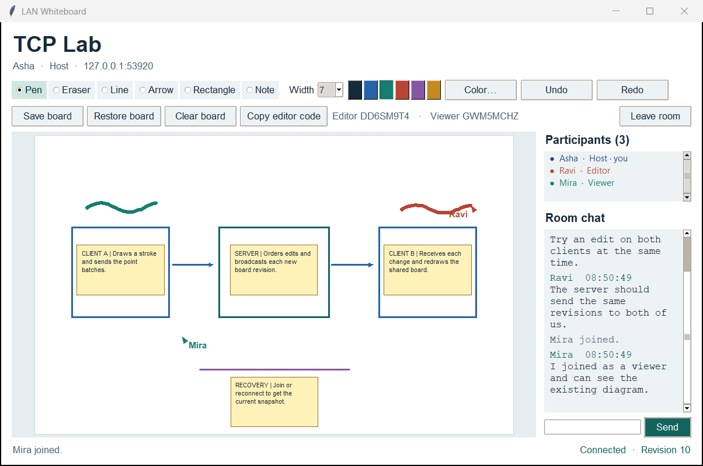

# LAN Whiteboard

A Computer Networks lab project for drawing and chatting together over a LAN. Run one Python TCP server on the host machine and open the Tkinter client on each participant's machine. The host creates a room, then shares its editor or viewer code.

| Team member | Roll number |
|---|---|
| L. Guna | **cs24b2043** |
| B. Rakesh | **cs24b2039** |
| L. Bhupesh | **cs24b2029** |
| R. Suhaas | **cs24b2040** |

## Submission files

| Deliverable | Download |
|---|---|
| Server application (Windows x64) | [WhiteboardServer.exe](submission/WhiteboardServer.exe?raw=1) |
| Client application (Windows x64) | [WhiteboardClient.exe](submission/WhiteboardClient.exe?raw=1) |
| Source code (three Python files) | [source-code.zip](submission/source-code.zip?raw=1) |
| Technical report and user guide | [technical-report.pdf](submission/technical-report.pdf) |
| Presentation | [presentation.pptx](submission/presentation.pptx?raw=1) |

## Network architecture

~~~mermaid
flowchart LR
    H["Tkinter client · Host"] <-->|"IPv4 TCP"| S["Python server · Port 5050"]
    E["Tkinter client · Editor"] <-->|"IPv4 TCP"| S
    V["Tkinter client · Viewer"] <-->|"IPv4 TCP"| S
    S --> R["Room state · Board, revision, roles, chat"]
~~~

~~~mermaid
sequenceDiagram
    participant E as Editor
    participant S as Server
    participant J as Joining client
    J->>S: join (name, room code)
    S-->>J: welcome, then snapshot at revision r
    E->>S: start and point batches
    S-->>J: draft and draft_points
    E->>S: finish (operation number)
    S-->>E: change at r+1
    S-->>J: change at r+1
~~~

- `server.py` owns the authoritative room state and handles permissions, sequencing, snapshots, and chat.
- `client.py` handles the Tkinter interface and maps each window onto the same 960 × 600 board. Background threads handle sockets, and the Tk event loop updates widgets.
- `protocol.py` defines the shared frame format, drawing bounds, and heartbeat settings.

### Protocol and concurrency

Each TCP frame consists of a 4-byte unsigned big-endian body length and a UTF-8 JSON object. TCP delivers ordered bytes. The length prefix lets the reader find message boundaries across partial or combined socket reads.

| Request body | Server action |
|---|---|
| `{"type":"join","name":"Ravi","code":"A3K7P9WV"}` | Resolves the room and role, then queues a welcome and snapshot. |
| `{"type":"finish","op":12}` | Commits the current pen draft and broadcasts the next board revision. |
| `{"type":"chat","op":13,"text":"The diagram is ready."}` | Broadcasts the message with the sender's name and a server timestamp. |
| `{"type":"sync"}` | Returns a full snapshot with the current board and recent chat. |

A room lock orders state changes and queues each broadcast in that order. Each connection has its own bounded FIFO send queue and writer thread. An overloaded or stalled peer is disconnected so other participants can keep working. The client batches pointer and pen events on a 33 ms timer and sends compact increments during a stroke. A normal commit updates one item. Snapshots are used on join, reconnect, revision recovery, clear, and restore.

The server skips already-seen operation numbers for the same participant identity. Clients skip older board revisions and request a snapshot if a revision is missing. Heartbeats run every four seconds on idle connections. A client that loses its socket retries with a resume token and recovers the current board and recent chat. An unfinished stroke is discarded on disconnect.

Undo and redo apply to the user's own actions, including erasures. If Ravi erases Asha's rectangle, Asha's redo leaves it hidden until Ravi undoes his erasure. Saving records the visible board in a versioned JSON file. Clearing or restoring starts a new undo history for everyone.

## Run on a LAN

1. Extract [source-code.zip](submission/source-code.zip?raw=1) to a folder on each machine or copy the source there before the offline demo. Use Python 3.11 or later with Tkinter. Run `python -m tkinter` to check the installation. Some Linux distributions package Tk separately.
2. On the server machine, open a terminal in the project folder and start the server.

   ~~~text
   python server.py --bind 0.0.0.0 --port 5050
   ~~~

3. Find the server's LAN IPv4 address with `ipconfig` on Windows or `ip -4 addr` on Linux. If prompted, allow incoming TCP on the chosen port for the private network. The clients need a route to the server over the LAN.
4. Open the client on each machine.

   ~~~text
   python client.py
   ~~~

5. Enter the server IPv4 address, port, and username. The host enters a room name and selects **Create room**. Each participant enters the appropriate room code and selects **Join room**. Use `127.0.0.1` if all clients run on the server machine.

On Linux, use `python3` if that is the installed command. Once Python and Tk are present, the application needs only the LAN connection. Linux source use has yet to be tested.

### Run the Windows executables

Download the two Windows x64 executables from the submission table. They bundle their runtime. Start the server from PowerShell in the download folder, then open `WhiteboardClient.exe` on each participant’s machine and use the same room setup as above.

~~~text
.\WhiteboardServer.exe --bind 0.0.0.0 --port 5050
~~~

### Controls and permissions

- Use **Pen**, **Line**, **Arrow**, or **Rectangle** by dragging. Select a swatch or **Color…** and choose the line width. Click with **Note** to type a sticky note. Click an object with **Eraser** to remove it.
- The host and editors can draw and use **Undo** and **Redo**. Viewers can move their named pointer and participate in chat. Only the host can save, restore, or clear the board.
- The roster shows who is in the room. The chat panel shows names and timestamps in the order assigned by the server. New and returning users see up to 100 recent messages.
- Use the host's **Save board** to write the visible board to a JSON file. **Restore board** replaces the room's canvas with that file. Rooms and chat are held in memory during the server process. Restore a saved board into a new room after a restart.
- The room codes and all traffic travel over plaintext TCP. Use the project on a trusted classroom LAN.

## Team contributions

| Member | Roll number | Responsibility and demonstration |
|---|---|---|
| L. Guna | **cs24b2043** | TCP framing, socket lifecycle, concurrency and ordered broadcasts. Trace one frame through the reader, room lock and peer writer queue. |
| B. Rakesh | **cs24b2039** | Board state, per-user undo and redo, snapshots, persistence and reconnection. Demonstrate save, restore and recovery from a dropped connection. |
| L. Bhupesh | **cs24b2029** | Room creation and joining, presence, access control and chat. Demonstrate the editor and viewer roles, named cursors and chat history. |
| R. Suhaas | **cs24b2040** | Tkinter workspace, canvas rendering, drawing tools and point batching. Demonstrate colored strokes, erasing, shapes and notes. |

## Verification

Three Tkinter clients on Windows loopback exercised drawing, chat, roles, save and restore, and reconnect. A TCP test sent 40 edits from two concurrent senders and verified that all three clients received the same revision sequence. It also checked split and combined frames, duplicate operation numbers, and idle-peer timeout. A client test verified that a revision gap triggers a sync request.

For 50 small committed edits with three connected peers on Windows loopback, sender submission to remote socket receipt measured **0.12 ms median** and **0.22 ms p95**. This measurement ends before Tk rendering. The packaged server accepted a session and sent a snapshot, and the packaged client opened its lobby. A two-device offline LAN demonstration remains to be checked on the evaluation network.

## Screenshots

| Feature | Screenshot |
|---|---|
| Create or join via IPv4, port and room code | [Lobby](screenshots/01-create-or-join.png) |
| Concurrent pen strokes, colors and widths, diagrams, notes, live pointers and chat | [Shared drawing](screenshots/02-shared-drawing.png) |
| Late join with the current canvas, participants and chat history | [Viewer joins](screenshots/03-late-join-viewer.png) |
| Viewer permissions and server-side rejection of a host command | [Access control](screenshots/04-permissions.png) |
| Erase and per-user history | [Erase](screenshots/05-erase.png) · [Undo](screenshots/06-undo.png) · [Redo](screenshots/07-redo.png) |
| Local board file and room-wide replacement | [Save](screenshots/08-save.png) · [Clear](screenshots/09-clear.png) · [Restore](screenshots/10-restore.png) |
| Connection drop and recovery of the board and chat | [Reconnecting](screenshots/11-connection-lost.png) · [Rejoined](screenshots/12-reconnected.png) |
| Participant leaves while the others stay in the room | [Roster update](screenshots/13-participant-left.png) |
